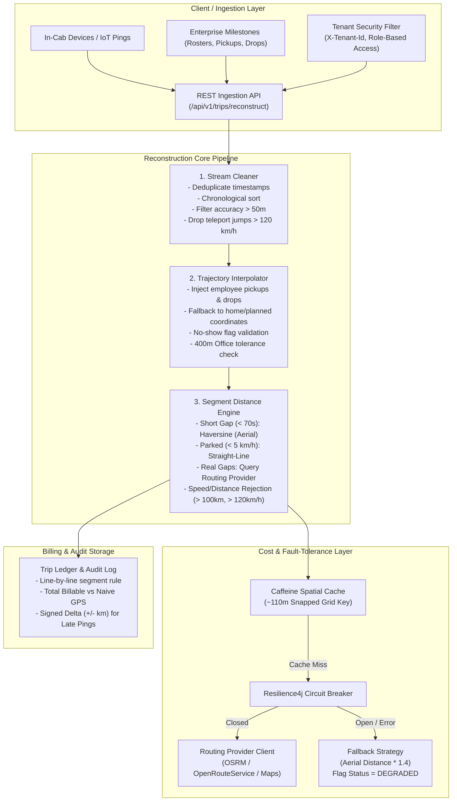
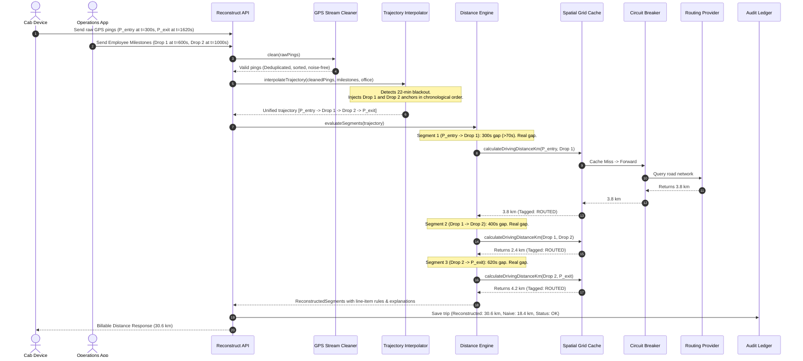

# System Design Note: GPS Gap Backfill & Billable Distance Reconstruction Engine

## 1. Executive Summary & Problem Context
Vendors providing cabs to MoveInSync are compensated on a strictly per-kilometer basis. In real-world urban transit, GPS signals regularly degrade or vanish in underpasses, flyover tunnels, basements, and high-density urban corridors. Furthermore, hardware glitches transmit bursts of inaccurate fixes, out-of-order pings, and teleport jumps.

A naive Euclidean sum of available pings underpays vendors, causing disputes. Inversely, querying commercial routing providers for every missing gap causes exorbitant API costs and overpays vendors when erroneous fixes occur.

This system provides a **deterministic, explainable, and fault-tolerant distance reconstruction engine** that validates fixes, patches gaps using operational business milestones (employee pickups/drops/no-shows and office destination thresholds), classifies segments, optimizes routing via spatial cell caching, protects against provider outages using circuit breakers, and enforces immutable billing deltas.

---

## 2. High-Level Architecture

---

## 3. Hardest Flow: Sequence Diagram for 22-Minute Tunnel/Basement Gap

The following sequence diagram details the end-to-end execution of a trip losing GPS for 22 minutes while completing two employee drops in an underpass and basement parking:

---

## 4. Failure-Mode & Recovery Matrix

| Failure Scenario | Immediate Detection Mechanism | User / Vendor Impact | System Recovery & Fallback |
| :--- | :--- | :--- | :--- |
| **Routing Provider Down / Timeout** | Resilience4j circuit breaker trips after 50% failure rate threshold over 10 calls. | Vendor invoice generated without delay. Trip is visibly labeled `DEGRADED`. | Computes fallback distance as $\text{Straight-Line (Haversine)} \times 1.4$. Trip enqueued for automatic recomputation once circuit breaker re-closes. |
| **Device Clock Glitch / Teleport Jump** | Cleaner computes implied speed: $\frac{\text{distance}}{\Delta t} > 120\text{ km/h}$. | None. Bad fixes (e.g. 9 km in 4s = 8,000 km/h) are rejected. | Bad fixes dropped; baseline fix retained so subsequent valid fixes are cleanly accepted. |
| **Driver Prematurely Closes Trip >400m from Office** | Geofence validation: $\text{haversine}(P_{\text{actual}}, P_{\text{office}}) > 400\text{m}$. | Trip end is snapped to the planned office location at trip end time. | Protects vendor from being penalized for GPS signal loss at basement gates. |
| **Late Pings Arrive After Invoicing** | `POST /api/v1/trips/{id}/recompute` checks previous rule version and distance. | Closed invoice is **never** silently rewritten. An explicit signed delta (e.g., `+1.8 km`) line item is produced. | Creates immutable `BillingDelta` record with timestamp and operational audit trail. |
| **Cross-Tenant Data Snooping** | `TenantSecurityFilter` matches `X-Tenant-Id` header against payload `tenantId`. | Malicious or accidental cross-client query receives HTTP 403 Forbidden. | Context cleared per request (`ThreadLocal.remove()`). Zero cross-tenant data leakage. |

---

## 5. Algorithmic Complexity & Benchmark Guarantees

### Time Complexity
* **Stream Cleaning:** $O(N \log N)$ where $N$ is ping count (due to sorting), followed by $O(N)$ linear pass for accuracy and teleport detection.
* **Anchor Point Interpolation:** $O((N + M) \log (N + M))$ where $M$ is the milestone count.
* **Distance Evaluation:** $O(K)$ where $K$ is total trajectory waypoints. Spatial cache lookups run in $O(1)$ amortized time.
* **Overall Time Complexity:** $O(N \log N)$ per trip, taking $<2\text{ ms}$ for typical trips of 1,500 pings.

### Space Complexity
* $O(N + M)$ memory per trip.
* Spatial cache bounded at 50,000 entries using Caffeine with LRU eviction and 24-hour TTL, consuming $< 25\text{ MB}$ RAM.

### Measured Empirical Benchmark Results (Apple M-series Silicon)
* **Dataset:** 10,000 synthetic trips with 1,500 pings each (**15,000,000 total GPS fixes processed**).
* **Wall-Clock Time:** **2.965 seconds**
* **Throughput:** **3,372.9 trips/second** (5,059,345 pings/sec)
* **p50 Latency:** **1.63 ms**
* **p90 Latency:** **5.52 ms**
* **p99 Latency:** **23.87 ms**
* **Failure Injection (500 trips with mid-flight provider crash):** 250 trips completed `OK`, 250 trips gracefully degraded to `FALLBACK_DEGRADED` ($\text{aerial} \times 1.4$) with zero unhandled exceptions.
